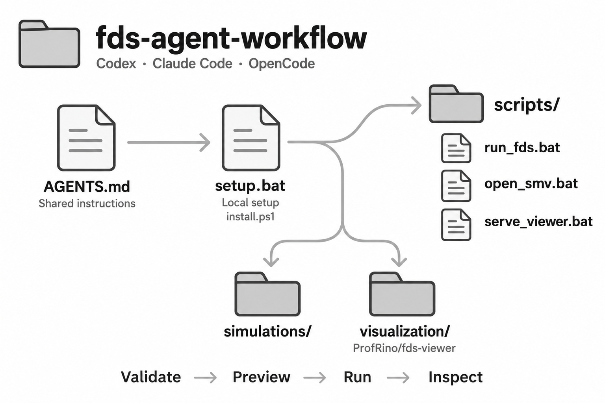

# FDS Agent Workflow

A portable Windows workspace for FDS with Codex, OpenCode or Claude Code.
The primary viewer is [ProfRino/fds-viewer](https://github.com/ProfRino/fds-viewer).
FDS4 research experiments and private simulations are not included.



## Install

1. Install the current [official FDS/Smokeview Windows bundle](https://pages.nist.gov/fds-smv/downloads.html),
   [Python 3.10+](https://www.python.org/downloads/windows/) and [Git for Windows](https://git-scm.com/download/win).
   The current FDS release when this starter was prepared was 6.11.1; check the
   official page for newer releases. This installer configures an existing solver;
   it does not silently install or update system software.
2. Download/extract this repository into a dedicated folder. Double-click setup.bat.
3. Setup detects Python, verifies the FDS executable, clones the viewer, creates
   folders and generates local batch launchers. No Python packages are needed.
4. Open this folder in your assistant. Codex and OpenCode use AGENTS.md; Claude
   receives the same instructions through CLAUDE.md. Terminal permissions and model
   authentication are configured in the assistant, not in this repository.

Custom installations, from PowerShell:

```powershell
.\install.ps1 -FdsInstall 'D:\Tools\FDS6' -SmokeviewExe 'D:\Tools\SMV6\smokeview.exe' -MpiProcesses 1
```

If execution policy blocks this command, use setup.bat with the same arguments;
its policy override applies only to that setup process. Read the script first.
For offline configuration use -SkipViewer, then obtain the viewer repository
separately and place its index.html directly inside visualization/.
Re-running setup regenerates launchers and configuration, but preserves viewer
files, inputs and results. Rerun setup after moving the folder or Python install.

## Run the public example

```bat
scripts\check_setup.bat
scripts\serve_viewer.bat
```

Open http://127.0.0.1:8765/visualization/index.html?file=/simulations/example_room/example_room.fds
and inspect geometry. In a second terminal:

```bat
scripts\run_fds.bat example_room --preview-confirmed
scripts\sim_status.bat example_room
scripts\open_smv.bat example_room
```

Alternatively load simulations/example_room into the viewer Output page. This is
a one-second inert box with a temperature slice, not a validated fire scenario.
The server binds only to localhost but serves this workspace; stop it with Ctrl+C.
Viewer CDN dependencies may require internet access.

For new cases, create simulations/CASE/CASE.fds with a unique CHID. Inputs can also
be passed as quoted project-relative paths. Existing output blocks reruns; create
a new case and CHID rather than deleting results. MPI defaults to one; --mpi N
overrides it. Multi-process execution depends on the FDS bundle's Intel MPI setup.

## Structure and privacy

- simulations/: cases and results; only the public example input is distributed.
- scripts/: shared Python tools and generated local .bat launchers/configuration.
- visualization/: separately downloaded upstream viewer, ignored by this repository.
- docs/, codes/, plots/, archive/: user documentation, standards, figures and backups.

Machine paths exist only in ignored scripts/config.local.json and generated .bat
files. Do not upload the complete installed folder. Use scripts/package_release.py,
which packages only files listed in distribution-files.txt and scans those files
for common credential and personal-path patterns. Automated scans are not a
guarantee: review every listed file before publishing. No telemetry is implemented.
Setup contacts GitHub to obtain the viewer; assistant providers have their own
data policies. Local file exclusions do not control what an assistant sends.

Tests: `py -3 -m unittest discover -s tests`. Package: `py -3 scripts/package_release.py`.
The ZIP is written under archive/ and excludes local settings and outputs.

## Licensing and limits

The scaffold and inherited validator retain the MIT license and author attribution.
FDS, Smokeview, and the viewer retain their respective upstream licenses. Obtain
standards and manuals from their publishers; do not redistribute private or
licensed documents. Solver execution is separate from physical/model validation.
All results require independent engineering verification before design use.

OpenCode's [official rules documentation](https://docs.opencode.ai/docs/rules/)
describes AGENTS.md support. Compatibility here means shared instructions and
terminal commands; no OpenCode session or model has been end-to-end tested.
